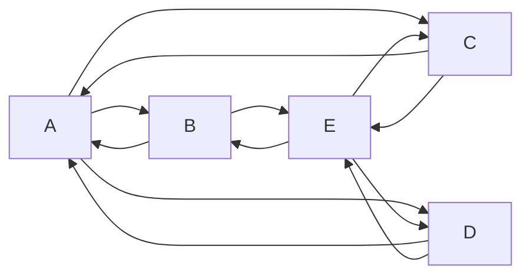

마크다운은 엔터를 줄바꿈으로 인정 x

엔터 두번이 줄바꿈  
공백 두번 후 엔터도 줄바꿈

문단 줄바꿈 <br> 줄바꿈

# 제목1
## 제목2
1. #과 ##은 구분선이 동반  
구분선은 ---, ___
---
___
### 제목3

순서없는 리스트
- 순서가 없음
    - tab을 이용한 들여쓰기
        - tab을 이용한 들여쓰기
            - tab을 이용한 들여쓰기
            *별표도 가능
            +플러스도 가능

순서 있는 리스트
1. 숫자로 구분
    1. tab도 가능
1. 숫자는 미리보기에서 강제로 순차적으로 반영
5. 100.을 해도 3으로 반영
---
-[ ] 대괄호 -> 체크박스 ? github issue, readme 특수문법  
-[x] 체크된 체크박스

*\*는기울이기* _\_는 기울이기_  
**\**는진하게**  
~~\~~는 취소선~~  
<mark>\<mark>는 형광펜 태그</mark> 

```
코드박스는 ``` 로 열기/ 닫기 
```
```python
print("hello world")
```



>인용
>>인용안에 인용
>>>끝까지 지원

